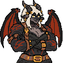
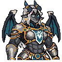
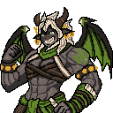
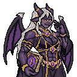
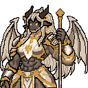

# Heartscale

> *"The strength that matters most is the one that learns to listen."*

**Heartscale** is a dating sim with deck building. For six weeks you train at the **Iron Scale Guild**, turn what you live through into cards, and learn to *read the moment* on dates with five dragon knights.

## What the game is about

You are a new member of the Iron Scale Guild. Each week you:

1. **Train** at the guild: combat, study or helping others. What you practice shapes who you become.
2. **Turn experiences into cards.** Training brings Challenge cards, studying brings Wit cards and helping brings Connection cards.
3. **Walk the guild grounds** and choose who to visit by going to her place.
4. **Go on a date.** You play cards to build Chemistry without letting Pressure get out of hand. The same card can win her over or ruin the moment depending on her mood, so you have to read her before acting.
5. **Look back on your week**: the cards you earned, how the date went and how close you have grown.

After the sixth week comes the **Festival of the First Flame**. You invite one of the dragons, or go alone, and the bond you built over the six weeks decides how the night ends.

*Every week leaves a mark: a skill, a card, a connection.*

## The dragons

| | Dragon | Where to find her |
| --- | --- | --- |
|  | **Kaela, The Smith.** Direct, competitive, and convinced the forge is a gym if you use it right. | Forge |
|  | **Veyra, The Knight.** Disciplined, precise, and secretly ready to be surprised. | Training Yard |
|  | **Sarka, The Brawler.** Loud, warm, impulsive, and happiest when everything is on the edge. | Arena |
|  | **Nyxara, The Arcanist.** Quiet, observant, and funnier than her notes suggest. | Archive |
|  | **Aurelia, The Guardian.** Protective, patient, and unused to anyone looking after her. | Gate |

Each dragon responds to you differently. Kaela respects a challenge but not endless competition. Veyra values variety. Sarka loves living on the edge. Nyxara rewards a sharp mind. Aurelia needs calm more than risk. Getting to know each one is learning how to spend time with her.

## Versions in this repository

The game was built in stages, and each folder holds a complete, playable version from one stage:

| Folder | Version |
| --- | --- |
| [`UISystems/`](UISystems/) | First version: the main menu, dragon selection and dialogue screens |
| [`ProgressionCycle/`](ProgressionCycle/) | Second version: weekly training, card packs and the card collection |
| [`MapScene/`](MapScene/) | Third version: the explorable guild grounds |
| [`FinalVersion/`](FinalVersion/) | **The complete game**, with dates, the weekly recap, the Festival and the final art |

Each folder has its own README with the details of that version.

## Play

Install [LÖVE 11.5](https://love2d.org/), then:

```sh
love FinalVersion
```

## License

[MIT](LICENSE)
